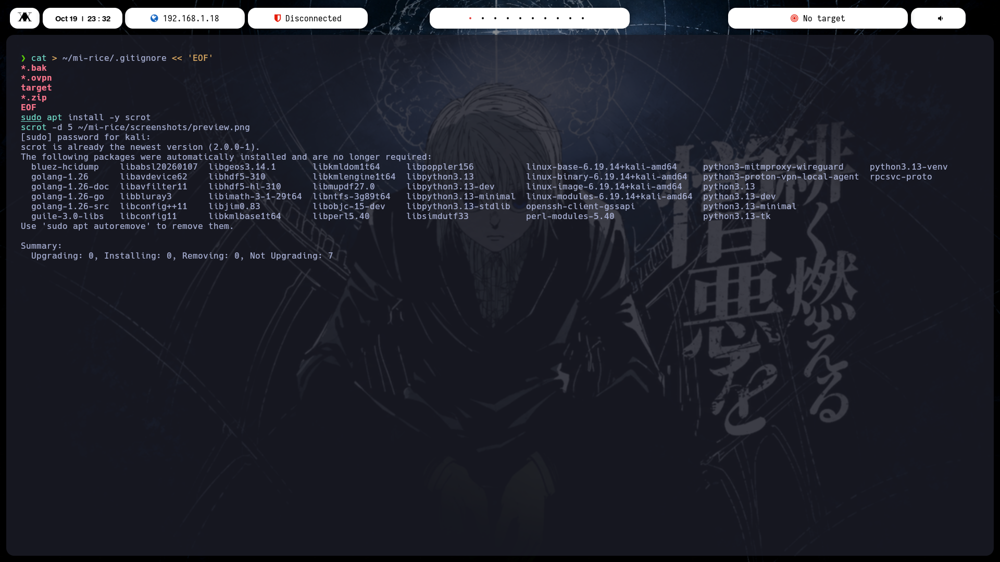

<div align="center">

# EstebanCRO - Kali bspwm Rice

Entorno de escritorio para Kali Linux basado en bspwm, orientado a pentesting y laboratorios de HackTheBox. Incluye barra de estado, herramientas propias en Bash e instalación automatizada.




</div>

---

## Contenido

1. [Descripción](#descripción)
2. [Características](#características)
3. [Requisitos](#requisitos)
4. [Instalación](#instalación)
5. [Estructura del repositorio](#estructura-del-repositorio)
6. [La barra de estado](#la-barra-de-estado)
7. [Herramientas incluidas](#herramientas-incluidas)
8. [Atajos de teclado](#atajos-de-teclado)
9. [Personalización](#personalización)
10. [Solución de problemas](#solución-de-problemas)
11. [Restaurar tu configuración anterior](#restaurar-tu-configuración-anterior)
12. [Uso responsable](#uso-responsable)
13. [Créditos](#créditos)

---

## Descripción

Este repositorio reúne la configuración completa de un escritorio ligero para Kali Linux. Parte del instalador AutoBspwm de ZLCube y lo extiende con una barra rediseñada, un selector de fondos con vista previa, un cambio de tema, un menú de herramientas y utilidades para organizar el trabajo en cada máquina de laboratorio.

Todo se instala con un solo script y cualquier cambio previo en tu sistema se respalda antes de ser reemplazado.

## Características

| Función | Descripción |
|---|---|
| Barra de estado | Fecha, IP local, estado de la VPN, target actual, escritorios y volumen, con bloques redondeados |
| Selector de fondos | Cuadrícula con miniaturas en rofi; el fondo elegido se conserva entre sesiones |
| Tema claro y oscuro | Un comando invierte los colores de la barra y de sus módulos |
| Menú de herramientas | Escaneos con nmap, acceso a la carpeta de la máquina y atajos a otras utilidades |
| Carpetas por máquina | `htb nombre ip` crea la estructura de trabajo y actualiza el target de la barra |
| Banner de terminal | Arte ASCII aleatorio junto a fastfetch; se adapta al ancho de la ventana |
| Icono propio en la barra | `mkicon.sh` convierte cualquier imagen en un icono de fuente para polybar |
| Instalación automatizada | Paquetes, configuraciones, scripts, fuentes y respaldo en un solo paso |

## Requisitos

- Kali Linux (probado en Kali 2026.2 sobre VMware Workstation Player).
- Usuario normal con permisos de `sudo`.
- Conexión a internet durante la instalación.
- Unos 500 MB libres para paquetes y fuentes.

## Instalación

Ejecuta el instalador con tu usuario normal, sin `sudo`. El propio script pedirá la contraseña cuando la necesite.

```bash
git clone https://github.com/Esteban4-CRo/EstebanCRO.git
cd EstebanCRO
chmod +x install.sh
./install.sh
```

Al terminar, cierra sesión y elige **bspwm** en la pantalla de inicio de sesión.

### Qué hace el instalador

1. Verifica que no se ejecute como root y que el sistema sea Kali (si no lo es, pide confirmación).
2. Instala los paquetes de `packages.txt` con `apt`. Si detecta VMware, instala además `open-vm-tools-desktop`.
3. Mueve las configuraciones existentes a `~/.config-backups/<fecha-hora>/` y copia las del repositorio a `~/.config`.
4. Copia `.zshrc` y `.p10k.zsh` a tu carpeta personal, con respaldo previo.
5. Instala los scripts en `~/.local/bin` con permisos de ejecución. `settarget` se instala en `/usr/local/bin`, por lo que pide `sudo`.
6. Descarga las Nerd Fonts que falten (Iosevka y Hermit) y actualiza la caché de fuentes.
7. Crea `~/Pictures/wallpapers` y copia allí las imágenes de la carpeta `wallpapers/`, si las hay.

## Estructura del repositorio

```text
EstebanCRO/
├── install.sh          Instalador
├── packages.txt        Paquetes de apt que se instalan
├── config/
│   ├── bspwm/          Gestor de ventanas y programas que arrancan con la sesión
│   ├── sxhkd/          Atajos de teclado
│   ├── polybar/        Barras, colores y scripts de los módulos
│   ├── picom/          Transparencias y sombras
│   ├── rofi/           Lanzador y temas
│   ├── kitty/          Terminal
│   ├── fastfetch/      Módulos que muestra el banner
│   └── bin/            Scripts de los módulos de la barra (IP, VPN, target)
├── scripts/            Herramientas que se instalan en ~/.local/bin
├── zsh/                .zshrc y .p10k.zsh
├── wallpapers/         Carpeta para tus fondos (vacía en el repositorio)
└── screenshots/        Capturas usadas en este README
```

## La barra de estado

La barra se compone de varias barras pequeñas que lanza `polybar/launch.sh`. Cada bloque es un módulo independiente:

| Módulo | Qué muestra | Origen |
|---|---|---|
| Logo | Icono de la izquierda, generado con `mkicon.sh` | fuente HunterIcon |
| Fecha y hora | Fecha y hora actuales | módulo `date` |
| IP local | Dirección de `eth0` | `config/bin/ethernet_status.sh` |
| VPN | Dirección de `tun0` o el aviso de desconexión | `config/bin/htb_status.sh` |
| Escritorios | Estado de los espacios de trabajo de bspwm | `config/polybar/workspace.ini` |
| Target | IP y nombre de la máquina en la que trabajas | `config/bin/htb_target.sh` |
| Volumen | Nivel de audio | módulo `alsa` |
| Apagado | Menú de apagado y cierre de sesión | `polybar/scripts/powermenu_alt` |

Los colores de los bloques se definen en `config/polybar/colors.ini` (`bg` para el fondo y `white` para el texto).

## Herramientas incluidas

### setwall

Selector y gestor de fondos de pantalla. Lee las imágenes de `~/Pictures/wallpapers`.

```bash
setwall pick       # abre una cuadrícula con miniaturas para elegir
setwall restore    # vuelve a poner el último fondo elegido (lo usa bspwmrc al iniciar)
setwall random     # pone uno al azar
setwall /ruta/imagen.png
```

Se llama `setwall` y no `wall` porque `wall` ya es un comando del sistema que envía mensajes a todas las terminales.

### htb y newbox

`newbox` crea la carpeta de trabajo de una máquina y guarda su IP en el target de la barra. `htb` es una función de zsh que además te deja dentro de la carpeta.

```bash
htb Nombre 10.10.11.5
```

Crea `~/HTB/Nombre/` con las carpetas `nmap/`, `content/`, `exploits/` y `scripts/`, además de `ip.txt`. Valida el nombre y la IP antes de crear nada.

### settarget

Cambia el target que muestra la barra sin crear carpetas.

```bash
settarget 10.10.11.5 Nombre
```

### kmenu

Menú en rofi con escaneos de nmap sobre el target actual, acceso a la carpeta de la máquina, cambio de fondo y de tema, y reinicio de la barra. Los escaneos solo deben usarse sobre máquinas de laboratorio autorizadas.

### tema

Alterna entre tema claro y oscuro en la barra.

```bash
tema            # alterna
tema claro
tema oscuro
```

### mkicon.sh

Convierte una imagen en una fuente de un solo carácter para usarla como icono en polybar. Requiere `potrace`, `fontforge` e `imagemagick`.

```bash
mkicon.sh logo.png              # logo oscuro sobre fondo claro
mkicon.sh logo.png --invertir   # logo claro sobre fondo oscuro o transparente
```

### ascii_resize.py

Normaliza arte ASCII hecho con caracteres braille para que todos los archivos tengan el mismo tamaño. Requiere `python3-pil`.

```bash
python3 ascii_resize.py ~/.config/ascii/original ~/.config/ascii --cols 44 --rows 22
```

## Atajos de teclado

Todos los atajos se definen en `config/sxhkd/sxhkdrc`. Para ver la lista completa en tu sistema:

```bash
grep -v '^#' ~/.config/sxhkd/sxhkdrc | grep -v '^$'
```

Tras editar el archivo, recarga los atajos con `pkill -USR1 -x sxhkd`.

## Personalización

**Colores de la barra.** Edita `~/.config/polybar/colors.ini`. Los valores usan el formato `#AARRGGBB`, donde `FF` es opaco. Reinicia la barra con `~/.config/polybar/launch.sh &`.

**Fondos.** Copia tus imágenes a `~/Pictures/wallpapers` y elige con `setwall pick`. Se recomiendan imágenes de al menos 1920x1080 y sin espacios en el nombre.

**Banner ASCII.** Crea la carpeta con `mkdir -p ~/.config/ascii` y guarda un archivo `.txt` por diseño. Al abrir una terminal se elige uno al azar. Con 90 columnas o más se muestra el arte junto a la información del sistema; en ventanas más estrechas solo se muestra la información, para evitar que se deforme. El umbral se cambia en `zsh/.zshrc`.

**Datos del banner.** Edita la lista de módulos en `~/.config/fastfetch/config.jsonc`.

**Logo de la barra.** Genera la fuente con `mkicon.sh`, regístrala en `current.ini` como una fuente nueva y úsala en el módulo `my-text-label`.

**Resolución en VMware.** Si la pantalla no llena la ventana, ejecuta `xrandr` para ver las resoluciones disponibles y `xrandr --output Virtual-1 --mode 1920x1080`. El nombre de la salida puede variar.

## Solución de problemas

| Problema | Causa probable | Solución |
|---|---|---|
| `Permission denied` al editar archivos de `~/.config` | Los archivos pertenecen a root por haberse copiado con `sudo` | `sudo chown -R $USER:$USER ~/.config ~/.local` |
| Los comandos propios no se encuentran | `~/.local/bin` no está en el `PATH` | Verifica que `.zshrc` contenga `export PATH="$HOME/.local/bin:$PATH"` |
| Iconos como cuadros vacíos | Falta una Nerd Font | `fc-list \| grep -i nerd` y ejecuta `fc-cache -f` |
| La barra no aparece | Error en algún módulo | Ejecuta `~/.config/polybar/launch.sh` en una terminal y lee los mensajes |
| Aviso de powerlevel10k sobre salida en consola | El banner se imprime antes del bloque de instant prompt | El banner debe estar al inicio de `.zshrc`, antes de ese bloque |
| El banner aparece dos veces | Otro archivo (como `.bashrc`) también ejecuta fastfetch | Busca con `grep -n fastfetch ~/.bashrc ~/.profile` |
| El fondo no se aplica al iniciar | La carpeta de fondos está vacía | Copia al menos una imagen a `~/Pictures/wallpapers` |
| La barra queda mal colocada tras cambiar la resolución | Las barras se posicionan al arrancar | Ejecuta `~/.config/polybar/launch.sh &` |

## Restaurar tu configuración anterior

El instalador guarda lo que reemplaza en `~/.config-backups/<fecha-hora>/`. Para volver atrás, copia de nuevo la carpeta que necesites, por ejemplo:

```bash
cp -r ~/.config-backups/20261020-153000/polybar ~/.config/
```

## Uso responsable

Las herramientas de escaneo incluidas están pensadas para laboratorios y sistemas sobre los que tienes autorización expresa, como HackTheBox, TryHackMe o tu propia red. El autor no se responsabiliza del uso indebido.

## Créditos

- [AutoBspwm](https://github.com/ZLCube/AutoBspwm) de ZLCube: base del entorno bspwm para Kali.
- [mkhmtdots](https://github.com/mkhmtolzhas/mkhmtdots) de mkhmtolzhas: referencia para la estructura del repositorio y del instalador.
- S4vitar: referencia del estilo de entorno bspwm para pentesting en la comunidad hispanohablante.
- [Nerd Fonts](https://www.nerdfonts.com/), [polybar](https://github.com/polybar/polybar), [bspwm](https://github.com/baskerville/bspwm), [sxhkd](https://github.com/baskerville/sxhkd), [rofi](https://github.com/davatorium/rofi), [picom](https://github.com/yshui/picom) y [fastfetch](https://github.com/fastfetch-cli/fastfetch).

---

<div align="center">

Mantenido por [Esteban4-CRo](https://github.com/Esteban4-CRo)

</div>
